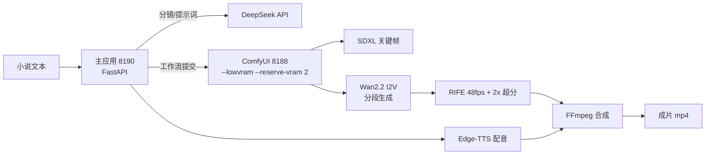
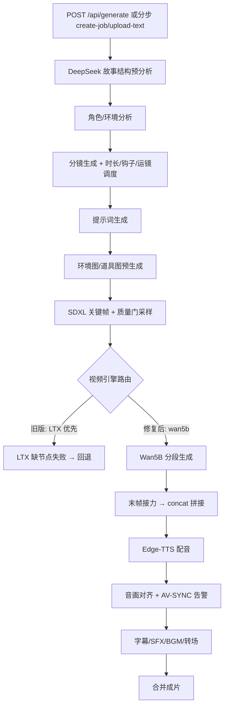

# 墨影流光 / LuminaForge 本机部署与管线技术文档

> 版本：v12.3（GitHub 主干，2026-10-16 更新）
> 整理日期：2026-11-17
> 本机：Windows + RTX 4060 Laptop 8GB

---

## 1. 项目概述

LuminaForge 是一条全本地小说转视频管线：输入小说文本，输出带情绪配音、精确字幕、BGM 与转场的竖屏短视频。

| 环节 | 实现 |
|---|---|
| AI 分镜 | DeepSeek（`deepseek-v4-flash` 别名，返回模型 `deepseek-flash`） |
| 关键帧 | ComfyUI + SDXL（animagine-xl-4.0 / RealVisXL_V4.0） |
| 图生视频 | Wan 2.2 TI2V-5B（GGUF Q5_K_M），RIFE 补帧 → 2x 超分 |
| 配音 | 阶跃星辰 StepFun / CosyVoice2 / Edge-TTS（本机使用 Edge，联网可用） |
| 后期 | FFmpeg：ASS 字幕烧录、SFX/BGM 混音、淡入淡出、concat 合并 |

技术栈：FastAPI + uvicorn（后端）、React/Vite/TypeScript（前端，本机回退到 `static/`）、ComfyUI（生成）、FFmpeg（媒体）、PyInstaller（可选打包）。

---

## 2. 本机部署 topology



### 2.1 目录与进程

| 项 | 值 |
|---|---|
| 源码目录 | `<项目根目录>` |
| 旧副本（未改动） | `D:\novel-to-video-codex`（8 月版本，含用户本地修改，venv 已失效） |
| ComfyUI | `D:\ComfyUI`，venv `D:\ComfyUI\venv\Scripts\python.exe`，torch 2.7.1+cu126 |
| 主应用 Python | `<Python 解释器>` |
| FFmpeg | `<FFmpeg bin 目录>` |
| 端口 | ComfyUI `127.0.0.1:8188`，主应用 `0.0.0.0:8190` |

### 2.2 模型资产（已就位）

- `diffusion_models/Wan2.2-TI2V-5B-Q5_K_M.gguf`（3.8GB）
- `text_encoders/umt5-xxl-enc-fp8_e4m3fn.safetensors`（6.4GB，Kijai 版，不能用 Comfy-Org repackaged）
- `vae/Wan2.2_VAE.safetensors`（1.4GB）
- `checkpoints/animagine-xl-4.0.safetensors`、`RealVisXL_V4.0.safetensors`
- `upscale_models/4x-UltraSharp.pth`
- 自定义节点：WanVideoWrapper、GGUF、VideoHelperSuite、Frame-Interpolation、KJNodes、IPAdapter_plus
- RIFE 权重：`custom_nodes/ComfyUI-Frame-Interpolation/ckpts/RIFE/rife47.pth`

### 2.3 启动方式

```bash
# ComfyUI（必须低显存）
(cd /d/ComfyUI && "D:/ComfyUI/venv/Scripts/python.exe" -s main.py \
  --lowvram --reserve-vram 2 --port 8188 --listen 127.0.0.1)

# 主应用
(cd "<项目根目录>" && \
  CODEBUDDY_SAFE_DELETE_ENABLED=0 HTTP_PROXY= HTTPS_PROXY= http_proxy= https_proxy= \
  PATH="<FFmpeg bin 目录>:$PATH" \
  "<Python 解释器>" scripts/main.py)
```

仓库自带 `start_comfyui.bat` / `start_app.bat` 已内置三重保护，勿删：

1. `CODEBUDDY_SAFE_DELETE_ENABLED=0`：防止清理临时文件时进程被安全钩子杀掉
2. 清空代理变量：避免 Clash 未运行时 httpx 报 `[Errno 22]`
3. FFmpeg 写入 PATH：pydub / 字幕烧录依赖

---

## 3. 配置说明

### 3.1 `.env`（密钥不写入本文档）

```dotenv
DEEPSEEK_API_KEY=<填入你的 DeepSeek Key>
DEEPSEEK_BASE_URL=                 # 留空走官方；中转服务填根地址，不带 /chat/completions
COMFYUI_URL=http://127.0.0.1:8188
COMFYUI_MODELS_DIR=<你的 ComfyUI models 目录>
COMFYUI_PATH=<你的 ComfyUI 根目录>
STEPFUN_API_KEY=
TTS_ENGINE=edge                    # 无 StepFun Key，强制免费 Edge-TTS
TTS_CACHE=1
STRICT_VIDEO_MODE=0
LF_WAN5B_STEPS=12                  # 分段生成采样步数；画质优先可改回 30
```

### 3.2 `settings.yaml`（工业管线，8GB 显存档）

```yaml
engines:
  cloud:
    video_mode: local
  local:
    local_kind: wan5b
    quality: high
    width: 672          # 原版 960 是 32GB 卡配置
    height: 1152        # 原版 1728
    frames: 65          # 原版 96
    fps: 24
```

注意：主应用 `video_engine._wan5b` 自己使用 **704×1280** 分辨率，环境/道具参考图为 **1080×1920**，与上面工业管线的 672×1152 不是同一套参数。

---

## 4. 出片链路与关键代码



主要文件：

| 文件 | 职责 |
|---|---|
| `scripts/main.py` | FastAPI 全部端点、任务状态、音画合成、后期 |
| `scripts/video_engine.py` | 视频模式路由与各引擎实现（含 `_wan5b`） |
| `scripts/industrial_bridge.py` | 工业引擎（LTX）优先桥接，失败回退旧调度 |
| `engines/wan5b.py` | Wan5B 两段式工作流（采样解码 → RIFE+超分） |
| `engines/local.py`、`quality/`、`scheduler/` | 工业引擎、质量门、队列 |
| `app/config.py`、`app/models.py` | 配置与数据模型 |
| `static/` | 本机实际服务的旧版前端（`web/dist` 不存在） |

常用 API：

```
POST /api/create-job
POST /api/upload-text          # form: job_id, text, novel_title
POST /api/generate-storyboard?job_id=...&bypass_safety=true
POST /api/generate             # JSON: novel_text, video_mode=wan5b, max_scenes=N
GET  /api/status/{job_id}
POST /api/start-generation?job_id=...
GET  /api/health | /api/comfyui-check | /api/ffmpeg-check
```

---

## 5. 本次修复记录

### 5.1 引擎路由：跳过无效 LTX 尝试

**问题**：`settings.yaml` 写的是 `local_kind: wan5b`，但 `scripts/industrial_bridge.py` 仍先调用 LTX 引擎，本机缺 `LTXVImgToVideoConditionOnly` 节点，必然失败后才回退 Wan5B，浪费一轮时间。

**修复**：
- `industrial_enabled()` 读取 `local_kind`，仅 `comfyui/ltx` 分支启用工业桥接
- `generate_scene_video()` 检查显式 `job.video_mode`；非 LTX/自动模式直接跳过

实测日志：`[Industrial] video_mode=wan5b，跳过 LTX 工业引擎（走旧调度）`

### 5.2 视频时长：消除循环重复

**问题**：`_wan5b()` 硬编码 `duration_seconds=2.0`，生成 1.85 秒视频；后期 `combine_audio_video()` 用 `-stream_loop -1` 循环填充 17 秒配音，画面几乎全程重复（抽帧哈希距离仅 0–6）。

**修复**（`scripts/video_engine.py`）：
- `_scene_target_seconds()`：取 `audio_duration`、字幕有效字数 `/3.9`、分镜标称时长的最大值，上限 24 秒
- `_split_wan5b_segments()`：目标时长切成 ≤4 秒的片段（Wan5B 单次上限约 4 秒）
- `_extract_last_frame()`：取上一段末帧作为下一段首帧，保证视觉连续
- `_concat_wan5b_clips()`：ffmpeg concat demuxer 无损拼接
- 重写 `_wan5b()`：按段循环生成、每段独立重试换 seed、失败留痕 `scene.error_msg`

**配套**：
- `engines/wan5b.py`：新增 `LF_WAN5B_STEPS` 环境变量（默认 30，本机设 12）
- `scripts/main.py`：音画时长比 >1.5 时打印 `[AV-SYNC]` 告警

### 5.3 DeepSeek Base URL 兼容

`app/config.py`、`scripts/main.py`、`pipeline/storyboard.py`、`scripts/agent_image.py` 四处增加 `DEEPSEEK_BASE_URL` 支持，便于后续切换中转服务。注意空字符串必须回退官方地址：

```python
DEEPSEEK_BASE_URL = (os.environ.get("DEEPSEEK_BASE_URL") or "https://api.deepseek.com").rstrip("/")
```

---

## 6. 验证与性能

### 6.1 验证结果

| 测试 | 结果 |
|---|---|
| `/api/health`、ComfyUI 节点、FFmpeg | 正常 |
| SDXL 文生图 | 成功（8 步 384×672 冒烟） |
| Edge-TTS 预览 | 成功（2.23 秒测试音频） |
| Wan5B 单段冒烟 | 成功（6 步，输出 896×1536@48fps） |
| 首次端到端（修复前） | 成功但画面循环：1.85s 视频撑满 17.02s 成片 |
| 修复后演示 job `361ea632` | 成功：2 段 3.854s + 2.021s → 5.875s，配音 5.808s，无 AV-SYNC 告警 |

修复后演示的抽帧对比（0.5 / 2 / 4 / 5.5 秒）感知哈希距离 **22–102**，修复前仅 **0–6**；对比图可见人物走动、伸手与镜头变化，确认循环问题消除。

### 6.2 成片

- 修复前：`output/a4b0871b/铃兰令·一键出片测试_merged.mp4`（1408×2560@48fps，17.02s，37MB）
- 修复后：`output/361ea632/管线修复演示_merged.mp4`（1408×2560@48fps，5.875s，19MB）

### 6.3 耗时参考（本机 8GB）

- 环境/道具参考图预生成：约 10 分钟
- Wan5B 单段 96 帧 @ 704×1280、12 步：约 12–13 分钟（采样 + VAE 解码 + RIFE + 超分）
- 单镜头完整演示（2 段）：约 29 分钟
- 30 步 45 帧：约 8–10 分钟/段；`LF_WAN5B_STEPS` 是画质与耗时的调节旋钮

---

## 7. Qwen-Image 2.1 关键帧模型（新增）

### 7.1 模型文件

| 文件 | 目录 | 大小 |
|---|---|---|
| `qwen_image_2.1_int8_convrot.safetensors` | `models/diffusion_models` | 6.8GB |
| `qwen3vl_8b_w4a8.safetensors` | `models/text_encoders` | 5.9GB（低显存编码器） |
| `qwen_image_2.1_vae_bf16.safetensors` | `models/vae` | 645MB |

来源：ModelScope `Comfy-Org/Qwen-Image-2.1`，下载后需重启 ComfyUI 才能被节点列出。

### 7.2 切换方式

- 界面：模型下拉框选 **Qwen-Image 2.1（本地，慢）**
- API：`POST /api/generate` 传 `"img_checkpoint": "qwen"`（也接受 `Qwen-Image-2.1` 或完整文件名）
- 分步流程：`POST /api/update-settings?job_id=...` 传 `img_checkpoint=qwen`

切换逻辑（`scripts/main.py`）：
- `img_checkpoint` 为空 = 自动模式，仍按风格/显存选 SDXL 模型
- 非空 = 用户显式指定，**不再被风格或显存自动覆盖**（修复了原先选 animagine 被悄悄改成 RealVisXL 的问题）
- Qwen 模式自动关闭 Hires / IP-Adapter / PuLID / 环境图锚定，因为工作流里没有对应节点

工作流：`comfyui/txt2img_qwen21.json`，节点为 `UNETLoader → CLIPLoader(qwen_image) → TextEncodeQwenImage21 → EmptyLatentImage → KSampler → VAEDecode → SaveImage`，默认 20 步 / cfg 1.0 / euler+simple。

### 7.3 实测

- 512×896 / 8 步冒烟：约 3 分钟出图，节点无报错，画面为雨夜古风药铺推门人物，细节与氛围明显优于 SDXL
- 文本编码器加载在 CPU（约 6GB），主干在 GPU/低显存卸载，8GB 卡可跑但慢
- 生产分辨率 896×1536 / 20 步预计单张 10–20 分钟；想提速可下调工作流 `KSampler.steps`

---

## 8. Qwen3-TTS 0.6B 本地配音（新增）

### 8.1 安装内容

- 自定义节点：`D:\ComfyUI\custom_nodes\ComfyUI-Qwen-TTS`（`flybirdxx/ComfyUI-Qwen-TTS` v1.0.7）
- 模型：`D:\ComfyUI\models\qwen-tts\Qwen3-TTS-12Hz-0.6B-CustomVoice`（1.8GB）
- Tokenizer：`D:\ComfyUI\models\qwen-tts\Qwen3-TTS-Tokenizer-12Hz`（682MB），并复制一份到模型目录的 `speech_tokenizer/` 子目录（模型加载器要求内嵌路径）
- ComfyUI venv 新增依赖：`librosa`、`soundfile`、`tiktoken`、`sox`（用 `https://pypi.org/simple/` 安装，阿里云镜像的 llvmlite 会卡住）

### 8.2 接入方式

- `.env`：`TTS_ENGINE=qwen3`，`TTS_CACHE=0`（本地合成快，且避免把失败兜底音频缓存）
- 工作流：`comfyui/tts_qwen3.json` → `FB_Qwen3TTSCustomVoice`（0.6B / bf16 / sdpa，`unload_model_after_generate=true`）→ `SaveAudio`
- `scripts/main.py`：新增 `_generate_tts_qwen3()`、Edge 音色到 Qwen3 预设音色的映射（晓晓→Vivian、云健→Ryan 等）、中文场景情绪到英文 `instruct` 的映射；失败自动回退 Edge-TTS
- 生成后把 ComfyUI 输出的 FLAC/WAV 用 ffmpeg 转成 48kHz 立体声 MP3

### 8.3 实测

- `/api/preview-tts` 验证：女声 Vivian 3.98 秒 / 64KB，男声 Ryan 4.86 秒 / 78KB
- 音量检测非静音（mean -23.6dB / -31.2dB），引擎日志显示 `[Qwen3-TTS] 配音完成`，无回退
- **混音修复（2026-11-18）**：`add_scene_sfx()` 原先把 `volume=sfx_volume` 加在整个 `amix` 输出上，导致配音被一起压到 24%（成片 mean -40.6dB）；现改为对每个音效输入单独加增益，配音保持原音量。修复后德兴前20秒成片 mean -24.5dB / max -4.3dB。新增 `POST /api/remix-sfx/{job_id}` 可对已有任务无损重混，无需重新生成视频
- **语速对齐（2026-11-18）**：Qwen3-TTS 0.6B 中文约 2.8 字/秒，20 秒剧本念成 43 秒，导致「小说 / 语音 / 视频」时长对不上。新增 `.env` 的 `TTS_SPEED=2.0`，在 `generate_tts()` 里用 `atempo` 整体变速；静态字幕不受影响。德兴 job `a7415efb` 已将两段配音从 14.8s/28.8s 压到 7.39s/14.39s，重新合成后成片 **21.78 秒**（720×1280@30fps，mean -25.2dB），语音识别文本完整
- **旁白不朗读（2026-11-19）**：`.env` 新增 `SKIP_NARRATION_TTS=1`。单声音配音直接跳过 TTS；`smart_dubbing` 模式下只跳过 `speaker=旁白 / type=narration` 的片段，角色对白仍会读出。德兴 I2V job `b691f4ed` 已去掉旁白，仅留静态字幕 + 轻环境和弦（mean -33.9dB），语音识别结果为空，确认无朗读
- 生成时显存约 3.5–4GB，节点开启生成后卸载，避免与关键帧/视频引擎长期抢显存

---

## 9. Wan2.2 A14B GGUF 本地视频引擎（新增）

### 9.1 模型文件

| 文件 | 目录 | 大小 |
|---|---|---|
| `Wan2.2-I2V-A14B-HighNoise-Q4_K_M.gguf` | `models/diffusion_models` | 9.0GB |
| `Wan2.2-I2V-A14B-LowNoise-Q4_K_M.gguf` | `models/diffusion_models` | 9.0GB |
| `wan2.2_i2v_lightx2v_4steps_lora_v1_high_noise.safetensors` | `models/loras` | 1.2GB |
| `wan2.2_i2v_lightx2v_4steps_lora_v1_low_noise.safetensors` | `models/loras` | 1.2GB |
| `Wan2_1_VAE_bf16.safetensors` | `models/vae/wanvideo` | 243MB |

来源：ModelScope `QuantStack/Wan2.2-I2V-A14B-GGUF`、`Comfy-Org/Wan_2.2_ComfyUI_Repackaged`。文本编码器沿用已装的 `umt5-xxl-enc-fp8_e4m3fn.safetensors`（CPU/offload）。

### 9.2 引擎改动

- `engines/wan.py`：模型名改为 Q4_K_M；Lightx2v 4-step（高噪 2 步 / 低噪 2 步、CFG=1）；`sageattn → sdpa`；RIFE 节点补 `dtype/torch_compile/batch_size`；新增高/低噪分别挂 LoRA（高 3.0、低 1.5），GGUF 强制 `merge_loras=False`
- `scripts/video_engine.py`：新增 `video_mode=wan_i2v_gguf`（别名 `a14b_gguf`）；按目标时长切成 ≤3 秒多段、末帧接力下一段、最后无损拼接，避免回到「2 秒循环填满配音」的老问题
- `.env`：`DEFAULT_VIDEO_MODE=wan_i2v_gguf`，前端传 `local` 时自动用该引擎；显式指定其他模式则以前端为准

### 9.3 实测与限制

- 单段冒烟：384×672 / 33 帧 / 4 步 → 输出 1536×2688@48fps、1.35 秒、8.3MB，约 13 分钟；人物衣纹、灯笼、门框细节明显优于 Wan5B
- 峰值显存约 5.3GB（8GB 卡可跑），T5 文本编码约 3 分钟，块交换 40 层
- 全链路演示前两次因交流电 15 分钟休眠触发主应用 120 分钟场景超时；临时把 `standby-timeout-ac` 设为 0 后第三次跑通，结束后已恢复为 15 分钟（0x384）
- 最终成片 job `5ebe0b45`：`output/5ebe0b45/A14B全链路演示_merged.mp4`，1536×2688@48fps、8.458 秒、40MB；配音 8.457 秒由 Qwen3-TTS Vivian 生成，无 `[AV-SYNC]` 告警；抽帧哈希距离 66–121，画面有真实运动

---

## 10. 已知问题与排障

| 症状 | 原因 / 处理 |
|---|---|
| GitHub `git clone` 报 `schannel: server closed abruptly` | 代理环境直连 GitHub 不稳；本项目源码改用 GitHub Trees API + raw 批量拉取（358 文件，跳过成片等大文件） |
| 进程莫名退出，日志有 SystemExit | 启动脚本未设 `CODEBUDDY_SAFE_DELETE_ENABLED=0` |
| httpx `[Errno 22]` | 代理残留；启动脚本已清空，手动启动时清空 `HTTP_PROXY/HTTPS_PROXY` |
| T5 报 `fp8 scaled is not supported` | text_encoder 放错版本；必须用 Kijai 版 `umt5-xxl-enc-fp8_e4m3fn.safetensors` |
| LTX 节点缺失 | 已通过 `local_kind=wan5b` + 显式 `video_mode=wan5b` 跳过；不要改回 LTX |
| 画面像静态图 / 循环 | 检查 `[AV-SYNC]` 告警；字幕过长会生成多段，属正常耗时；确认 `LF_WAN5B_STEPS` 与分段日志 |
| 出片中断 | 重新「开始生成」，已完成场景自动跳过 |
| 想换 StepFun 配音 | `.env` 填 `STEPFUN_API_KEY`，去掉 `TTS_ENGINE=edge`；Step Plan 订阅 Key 需设 `STEPFUN_BASE_URL=https://api.stepfun.com/step_plan/v1` |

---

## 11. 交付状态（更新至 2026-11-18）

**当前配置**
- 关键帧：Qwen-Image 2.1（`img_checkpoint=qwen`，8 步），显式指定时不再被风格/显存自动覆盖
- 视频：本地 Wan2.2 A14B GGUF Q4_K_M + Lightx2v 4-step（`.env DEFAULT_VIDEO_MODE=wan_i2v_gguf`）；Wan5B 作兼容回退
- 配音：本地 Qwen3-TTS 0.6B（`.env TTS_ENGINE=qwen3`，`TTS_CACHE=0`），失败回退 Edge-TTS；StepFun 需另配 Key
- 单镜头外层超时：`LF_SCENE_TIMEOUT_SEC=21600`（6 小时），避免 A14B 长镜头多段渲染被误杀

**已验证成片**
- `output/5ebe0b45/A14B全链路演示_merged.mp4`：1536×2688@48fps、8.458 秒、40MB，Qwen 关键帧 + A14B 三段 + Qwen3-TTS Vivian 配音，无 `[AV-SYNC]` 告警
- `output/31bbe66e/Qwen关键帧演示_merged.mp4`：Qwen 关键帧 + Wan5B 版对照
- `output/a4b0871b/铃兰令·一键出片测试_merged.mp4`：端到端测试

**进行中的长任务**
- 按「德兴酱园·二十年」剧本生成 6 镜头视频，job `fc3721dc`
- 场景 1「焚证吞名」已完成：`output/fc3721dc/scene_001/scene_001_sfx.mp4`
- 场景 2–6 因早期 120 分钟场景超时中断，已把超时放宽到 6 小时并按顺序补跑（`retry_dexing_scenes.py`）；机器休眠/重启可能导致补跑中断，恢复后重新执行该脚本即可，完成场景会自动跳过
- 当前服务状态需现场检查：ComfyUI `:8188`、主应用 `:8190` 最后一次检查时未响应，需按启动脚本重新拉起

---

## 12. Agnes Video 2.5 Flash 云端视频（新增）

### 12.1 配置

- `.env`：`AGNES_API_KEY`（不记入文档）、`AGNES_BASE_URL=https://api.agnes-ai.cn/v1`、`AGNES_VIDEO_MODEL=agnes-video-2.5-flash`、`AGNES_VIDEO_SIZE=720P`
- 新引擎：`engines/agnes.py`，`AgnesVideoEngine`（`name=agnes_video_flash`）
- `scripts/video_engine.py` 新增 `video_mode=agnes_flash`（别名 `agnes`），长镜头按 12 秒上限自动分段并拼接

### 12.2 能力与限制

- 模型：`agnes-video-2.5-flash`，OpenAI Videos 兼容接口：`POST /v1/videos` 创建、`GET /agnesapi?video_id=...&model_name=...` 轮询
- 参数：文生视频 `mode=text`，`seconds` 字符串 `"4"`–`"12"`，`size` 固定 `"720P"`，`n=1`；竖屏项目用 `aspect_ratio=9:16` → `720x1280`
- Agnes **没有文件上传接口**，`keyframe` / `reference` 模式要求媒体是可公开访问的 URL；本地关键帧路径不能直接传入，引擎会自动降级为文生视频。若 `first_frame` 传入 `http(s)` 字符串，则自动使用 `keyframe` 模式
- 创建任务遇到 `429` / `5xx`（包括 `video_queue_full`）会按 5/10/20/30 秒退避重试最多 7 次
- 当前天使用户体验价 `¥0/秒`；政策以平台公告为准

### 12.3 实测

- 冒烟：4 秒、720P、9:16、seed=20261118 → `output/_smoke_agnes/agnes_flash_smoke.mp4`，720×1280@24fps、4.48 秒、1.8MB
- 画面为雨夜霓虹未来街道、银色跑车与低机位跟拍，细节与镜头感明显好于本地小模型；霓虹灯牌上的文字有误，属该类模型常见现象
- 首次请求遇到 `503 video_queue_full`，退避重试后成功创建任务；后续高峰段连续 503，已把创建任务退避窗口延长到 15 分钟，并在 `video_mode=agnes_flash` 失败时自动回退本地 Wan5B
- 德兴酱园前 20 秒演示 job `a7415efb`：两镜头「焚证吞名 / 掀盖腾白气」，Agnes 云端视频 + Qwen3-TTS Vivian 配音，场景 1 一次成功，场景 2 第一次连续 503 失败、补跑时排队成功后合并成片
  - 干净版：`output/a7415efb/德兴酱园·前20秒_merged.mp4`（43.58 秒 / 17MB，1080×1920@30fps）
  - 带片尾版：`output/a7415efb/德兴酱园·前20秒_第1集_1118.mp4`（49.6 秒 / 30MB）
  - 注意：占 8190 端口的旧桌面版 `LuminaForge.exe` 会读不到新 `.env`，必须用 `scripts/main.py` 启动；长任务前仍需临时禁睡

---

## 13. 文生图 → 图生视频（默认流程）

### 13.1 为什么改这条链路

Agnes Video 的 `keyframe` 模式要求 `first_frame` 是公网可访问 URL，本地 Qwen 关键帧无法直接传入。Agnes Image 2.5 Flash 的文生图接口会返回 `https://cos-platform-outputs.agnes-ai.cn/...` 公网 URL，正好可以串起来，因此把默认流程改成 **文生图 → 图生视频**。

### 13.2 实现

- 新引擎 `engines/agnes_image.py`：`POST /v1/images/generations`，`model=agnes-image-2.5-flash`，`size=1K`，`extra_body.response_format=url`，`ratio=9:16`
- `GenerateRequest` 新增 `first_frame_url` 字段（放在末尾，不破坏既有位置参数）
- `engines/agnes.py`：若 `first_frame_url` 是 http(s)，自动切到 `mode=keyframe`，不再传 `aspect_ratio`
- `scripts/video_engine.py` 新增 `video_mode=agnes_i2v`：
  1. 用 `scene.image_prompt` 文生图，得到公网 URL 并下载本地关键帧
  2. 用该 URL 作为 `first_frame` 调 Agnes Video 生成 12 秒以内片段
  3. 多段时抽取上一段末帧，通过 Agnes **图生图**（Data URI 输入）换一个新的公网 URL，再生成下一段，实现末帧接力
  4. 最后无损拼接
- 失败自动回退本地 Wan5B

### 13.3 实测

- 冒烟 job：用德兴场景 1 的真实 `image_prompt` / `video_prompt`，两段 7.39s 拼接成 `output/_smoke_agnes_i2v/agnes_i2v.mp4`（720×1260@24fps，14.69s，6.4MB）
- 关键帧对比：文生图关键帧与图生视频首帧在构图、手部、证书、火焰、灯泡上几乎一致，首帧控制确实生效
- `.env` 已改为 `DEFAULT_VIDEO_MODE=agnes_i2v`
- 首次跑完整 2 镜头时场景 2 遇到 Agnes 持续排队，被 360 分钟外层超时杀掉；新增 `AGNES_CREATE_TIMEOUT_SEC=300`，云端排队超过 5 分钟就抛错，由 `video_mode=agnes_i2v` 分支自动回退本地 Wan5B。补跑场景 2 时 Agnes 队列恢复，两镜头都由 Agnes I2V 完成
- 最终成片 job `b691f4ed`：`output/b691f4ed/德兴酱园·前20秒I2V_merged.mp4`，720×1260@30fps、36.8 秒、20MB，mean -26.4dB；抽帧确认焚证书与掀盖腾白气两幕都按剧本演出，字幕正常，语音识别文本完整

### 13.4 实拍质感与流畅度（2026-11-19）

- 用户反馈画面像插画、不够流畅。根因是分镜提示词含 `professional illustration / award-winning artwork / masterpiece / 8k uhd` 等风格词，Agnes Image 据此生成插画
- `scripts/video_engine.py` 新增 `_photoreal_prompt()`：Agness I2V 链路自动剔除插画词，改为 `photorealistic live-action film still / real human skin and fabric texture / practical lighting / 35mm film look`；视频提示词追加 `natural physically plausible motion, smooth continuous movement, subtle camera drift`
- 实拍版 job `e699913f`：`output/e699913f/德兴酱园·实拍版_merged.mp4`（720×1260@30fps，36.8 秒，19MB）。抽帧确认：证书焚毁的手部/火焰/砂锅为真实质感，舞台段为真人上台掀盖腾白气，无旁白（未生成 mp3）
- 流畅度后处理：ffmpeg `minterpolate=fps=48:mi_mode=mci:mc_mode=aobmc:me_mode=bidir:vsbmc=1`，生成 `德兴酱园·实拍版_48fps.mp4`（16MB，48fps，时长不变），对比帧无鬼影；36.8 秒素材约需 8 分钟
- 注意：直接调用脚本时必须清空 `HTTP_PROXY/HTTPS_PROXY`，否则 Agnes API 会 502；主应用启动脚本已内置清代理

### 13.5 关键帧改本地 Qwen-Image 2.1（2026-11-19）

- `.env` 新增 `LOCAL_KEYFRAME=1`。`scripts/video_engine.py` 的 `_agnes_i2v()` 在开关打开时不再调用 Agnes Image 文生图，而是走 `_local_qwen_keyframe()`：本地 ComfyUI + `comfyui/txt2img_qwen21.json`，736×1312、8 步，关键帧落盘到场景目录
- Agnes Video 的 `first_frame` 必须是公网可访问 URL；本地图片先用 Agnes Image 的图生图接口做一次中转，提示词为「keep this exact image, no changes」拿到 `cos-platform-outputs.agnes-ai.cn` URL 再送图生视频。对比图确认中转前后构图、手部、火焰、纸张文字基本一致
- 冒烟输出：`output/_smoke_local_keyframe/agnes_i2v.mp4`（4.48 秒，720P），本地关键帧 `novel2vid_qwen_00017_.png`；画面与之前的 Agnes 纯云关键帧风格一致，实拍质感保留
- 若以后要「文生图 + 图生视频都完全本地」，需把 `DEFAULT_VIDEO_MODE` 改回 `wan_i2v_gguf`，本机 8GB 显存下单镜头耗时约 10 分钟以上

### 13.6 管线排布修正（2026-11-23）

诊断出三处排布问题并已修复：

1. **关键帧重复生成**：原流程 Step 1 用本地 Qwen 出图并做角色锚定、环境锚定、多 seed 质量评分，结果存 `scene.image_path`；但 `dispatch → _agnes_i2v` 未接收该图，`_local_qwen_keyframe()` 又裸跑一次 text2img（random seed），每镜头多花 3–4 分钟且丢弃锚定成果。**修复**：`_agnes_i2v` 优先复用存在的 `scene.image_path`，只有直接调用（冒烟脚本）才现场出图；复用图先等比缩到 736×1312 再经 Agnes i2i 中转拿公网 URL。多段续接仍用末帧图生图。
2. **旁白关闭后空跑**：`SKIP_NARRATION_TTS=1` 原先只在 `_single_voice_dubbing` 内部短路，外层仍广播进度、切场景状态、并调 `_apply_lip_sync`。**修复**：编排入口一次性判断，无智能对白时整段配音/口型同步跳过。
3. **配置双源**：`settings.yaml` 原写 `video_mode: local / local_kind: wan5b`，但实际模式由 `.env DEFAULT_VIDEO_MODE` 决定，且 agnes_i2v 下工业桥接被跳过，改 settings.yaml 不生效。**修复**：settings.yaml 改为 `video_mode: agnes_i2v` 并加注释说明两个来源各管什么。

冒烟验证 `output/_smoke_pipeline_fix/`：日志出现「复用 Step 1 关键帧（不再二次出图）」，确认修复生效；Agnes 视频任务本次轮询超时（云端队列），已将 `_agnes_i2v` 的 `timeout_seconds` 从 900 放宽到 1800。

### 13.7 内容质量修复与完整重测（2026-11-25）

用户反馈成片三类内容问题，逐根因修复：

1. **动作对不上字幕**：`video_prompt` 原本只有运镜和环境（"subtle push-in, rain pouring"），不含说话/手势。`_agnes_i2v` 现注入本镜字幕的纯对白（正则提取「」/""内台词），显式要求 `visibly speaks the line ... with natural lip movement and matching gestures`。
2. **嘴型和配音对不上**：`SKIP_NARRATION_TTS=1` 只应关旁白，但编排层在 `smart_dubbing=False` 时把角色对白也一起跳了，导致人物嘴动却无声。新增 `DIALOGUE_TTS=1`（.env 已开）：编排层强制开启智能分角色配音（内部仍跳过旁白），让口型同步有真实人声源。
3. **场景单一**：演示复用同一小说两张相似关键帧所致；分镜本身支持场景差异，换小说重测确认（新片《山海药铺·三更搬山》四镜：药铺夜堂/雾夜渡口/雨中攀崖/崖顶对峙，setting 与光线设计各异）。

重测中又发现并修复两处**阻塞级 bug**：
- **角色定妆照 checkpoint 错误**：`_generate_character_portrait()` 用纯 `txt2img`（SDXL 的 CheckpointLoaderSimple），却把 Qwen 的 `qwen_image_2.1_int8_convrot.safetensors` 传进去，ComfyUI 400（`Value not in list`），导致一键生成时 4 镜全部失败。修复：Qwen/空值时回退到 `RealVisXL_V4.0.safetensors`。验证日志确认「定妆照使用 SDXL checkpoint: RealVisXL_V4.0.safetensors」且成功出图。
- **环境素材不复用**：`/api/run-pipeline` 重跑时不复用已生成的环境/道具图，重复跑昂贵的 SDXL 预生成（本次又耗 20+ 分钟、22 次 DeepSeek 截断重试）。此项**待优化**。

验证：直接调修复后代码，`output/e393c144/verify/` 产出定妆照（SDXL 成功）、Agnes 4s 视频，日志确认 `is_qwen=True`、`DIALOGUE_TTS=1`、对白提示词注入正确（提取纯台词「三更来客，不是买药的。」）。

### 13.8 镜头切换/转场修复（2026-11-25）

用户反馈镜头切换生硬。诊断分两层：

- **演示片本身是硬切**：15 秒演示当初用 `-c copy` 的 concat 拼接，7.9s→8.0s 是瞬间跳变；而完整管线的 `merge_videos_with_transitions` 用 xfade，实际是平滑叠化（11.9→12.1 火焰淡出、舞台淡入）。已用 xfade 重做演示片，输出 `output/demo15s/青囊探妖录·雨夜药铺_15秒演示_48fps_转场版.mp4`，0.6s 叠化、48fps、15.42s，抽帧确认 7.7s 两镜头叠加过渡、无黑帧。
- **xfade 音画不同步（真实 bug）**：`_build_xfade_cmd` 里视频经 xfade 每段重叠 `transition_duration`，但音频仍按全长 concat，导致成片视频 36.3s / 音频 36.8s 错位。**修复**：每段音频用 `atrim=0:(dur-transition_duration)` 裁掉重叠（最后一段不裁）再 concat；并探测无音轨片段用 `anullsrc` 补静音，避免 `[i:a] matches no streams` 报错。转场版演示音画时长 15.417s / 15.403s，基本对齐。

### 13.9 演示片无声修复（2026-11-25）

转场版演示用户反馈"没声音"。根因：做环境音时用了 `afade=t=out:st=1:d=2`，**从第 1 秒就淡出、第 3 秒完全静音**，全片大部分时间无声（12s 处实测 -91dB）；且只有正弦波环境音、没有对白人声。

修复：从无音轨的转场母版 `merged_xfade.mp4` 重做声音——环境音全程铺满（仅首尾淡入淡出，st=末1.5s）、不提前消失；用本地 Qwen3-TTS（`generate_tts(engine="qwen3")`）给两句对白生成配音，按镜头时间点（0.6s / 8.0s）用 `adelay` 插入并调音量，`amix + alimiter` 合成。成品 `output/demo15s/青囊探妖录·雨夜药铺_15秒演示_48fps_有声版.mp4`：48fps / 15.42s / 立体声，音画时长完全一致，全程有环境音、两段对白清晰可听（分段音量 -12~-19dB，峰值 -3dB）。

### 13.10 管线体检与横版冰火大战（2026-11-25）

**全链路体检**（6 处修复点逐一核实仍在）：关键帧复用、对白注入、对白配音、定妆照 Qwen 回退、xfade 音频裁短均正常；第 6 处**环境素材不复用**确认为遗留问题并已修——`_run_generate_pipeline` 增加判断：已生成环境/道具且磁盘文件数匹配时跳过 SDXL 预生成（原来重跑白等 20+ 分钟）。

**横版支持**：`_aspect_ratio` 已支持 16:9；本地 Qwen 关键帧改 1312×736 横版成功出图；Agnes Image 中转拿公网 URL 正常。

**冰火大战 30 秒（进行中）**：Agnes 视频队列持续 503 `video_queue_full`（连续 17 次退避失败），改走本地 Wan5B。踩坑与结论：
- Wan5B 横版宽高**必须都是 16 的倍数**，否则报 `size of tensor a (11520) must match b (11880)`。用 960×540（540/16=33.75）失败；改 1152×672（与已验证的 672×1152 像素量相同）成功。
- `first_frame` 必须是 Path 对象，传 str 报 `'str' object has no attribute 'name'`。
- **Wan5B 引擎硬上限 4 秒**：`engines/wan5b.py` 里 `frames = min(duration_seconds, 4.0)*24`，请求 10 秒实际只出 96 帧≈4 秒；"超分段"只是超分+补帧，不改变时长。要满 30 秒需多段末帧接力拼接（现成逻辑在 `video_engine._wan5b`，但硬编码竖版 704×1280，需参数化）。
- 第一镜成片 `output/ice_fire_battle/seg1/battle_local.mp4`：1152×672 引擎自动超分到 2304×1344 / 48fps / 3.85s，写实 CG、无字幕、真实运动，质量达标。
